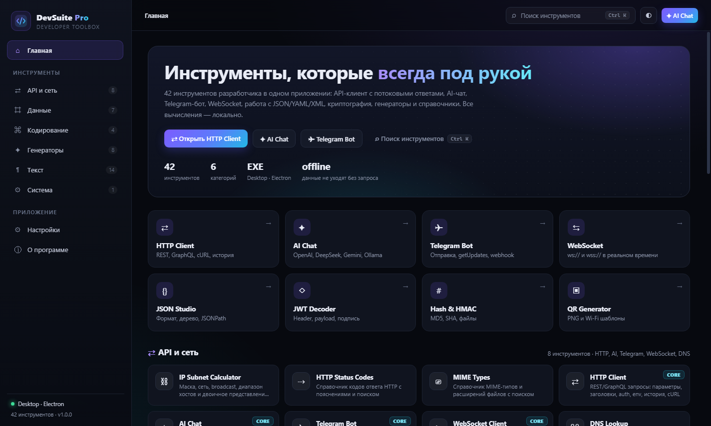
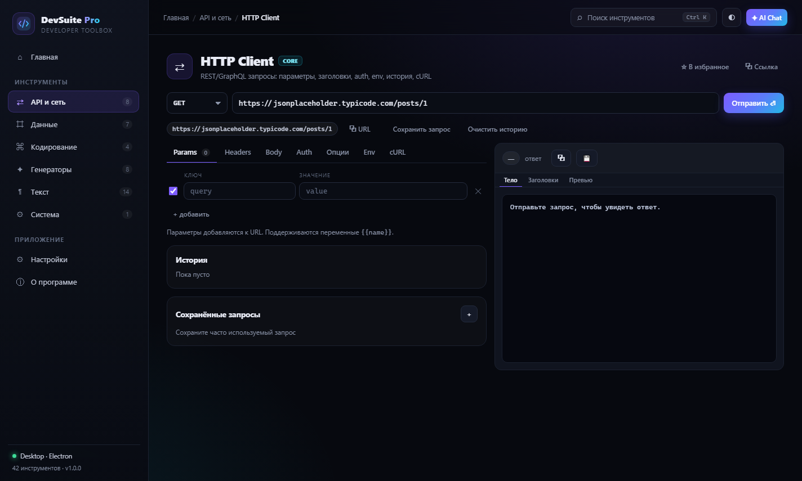
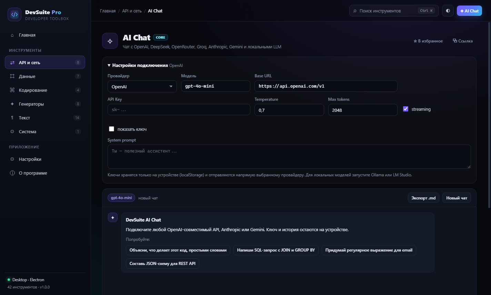
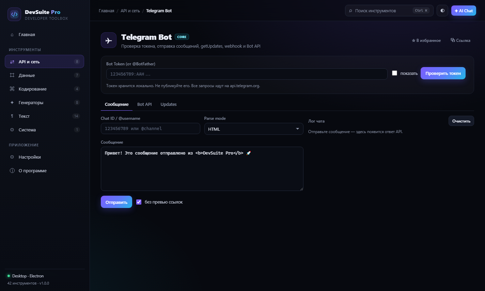

# DevSuite Pro 1.0.0

Набор из **42 инструментов разработчика** в одном приложении (плюс настройки и раздел «О программе») для Windows и Android.
Интерфейс полностью на русском языке, все вычисления выполняются локально, без телеметрии.

## Скриншоты

| Главная | HTTP Client |
| --- | --- |
|  |  |

| AI Chat | Telegram Bot |
| --- | --- |
|  |  |

## Скачать

- [Windows EXE, портативная версия 1.0.0](https://github.com/dimaonuk39-sudo/DevSuite-Pro/releases/latest/download/DevSuite-Pro-1.0.0.exe)
- [Android APK 1.0.0](https://github.com/dimaonuk39-sudo/DevSuite-Pro/releases/latest/download/DevSuitePro-1.0.0.apk)

## Состав поставки

| Файл | Назначение |
| --- | --- |
| `DevSuite-Pro-1.0.0.exe` | Портативная версия для Windows 10/11 (x64). Установка не требуется. |
| `DevSuitePro-1.0.0.apk` | Версия для Android 7.0+ (minSdk 24, targetSdk 34). |

EXE — портативный: настройки, избранное и история хранятся в профиле пользователя.
APK подписан отладочным ключом `DevSuite Pro`; для установки разрешите установку из неизвестных источников.

## API, AI и Telegram

* **HTTP Client** — REST/GraphQL, query-параметры, заголовки, авторизация, тело запроса,
  окружения и переменные, импорт/экспорт cURL, история и сохранённые запросы,
  потоковые ответы, предпросмотр изображений, отмена запроса.
  В EXE запросы идут через основной процесс Electron, в APK — через нативный
  HTTP-мост на `HttpURLConnection`, поэтому CORS не мешает работе с любыми API.
* **AI Chat** — OpenAI-совместимые API (OpenAI, DeepSeek, OpenRouter, Groq, Mistral,
  Together, Ollama, LM Studio), Anthropic и Google Gemini. Поддерживается SSE-поток,
  системный промпт, температура, история диалогов и экспорт.
* **Telegram Bot** — проверка токена, `sendMessage`, произвольные методы Bot API,
  `getUpdates` с автообновлением и журналом чата.
* **WebSocket Client** — `ws://` и `wss://`, отправка и приём сообщений в реальном времени.
* **DNS Lookup** — A, AAAA, CNAME, MX, NS, TXT, SOA через системный резолвер.

Ключи API и токен Telegram сохраняются только в локальном хранилище приложения.
Их можно удалить в разделе «Настройки».

## Состав инструментов

* **API и сеть:** HTTP Client, AI Chat, Telegram Bot, WebSocket Client, DNS Lookup.
* **Данные:** JSON Studio (формат, дерево, JSONPath), YAML ↔ JSON, XML Studio, CSV ↔ JSON,
  JWT Decoder с проверкой HS256/384/512, Diff Checker, Regex Tester.
* **Кодирование и криптография:** Base64 (текст и файлы), URL Codec & Parser,
  Hash & HMAC (MD5, SHA-1/256/384/512, файлы), AES-GCM с PBKDF2,
  UUID v4 / ULID / NanoID.
* **Генераторы:** пароли, QR-код, QR-сканер (камера), штрихкоды (CODE128, EAN, UPC и др.),
  фейковые данные, Lorem Ipsum, slug.
* **Текст и код:** SQL Formatter, CSS Formatter, Markdown Preview, Escape/Unescape,
  Unicode Inspector, Case Converter, текстовые утилиты, системы счисления,
  HTML-сущности, текст ↔ двоичный код.
* **Справочники и система:** конвертер цветов, timestamp, Cron Parser,
  Unix-права, IP-калькулятор подсетей, HTTP-статусы, MIME-типы,
  System Info, настройки, «О программе».

## Управление

* `Ctrl+K` — командная палитра с поиском по всем инструментам.
* `↑` / `↓` и `Enter` — навигация по результатам поиска.
* `Esc` — закрыть палитру или мобильное меню.
* `F12` — DevTools в версии для Windows.
* Тема (тёмная/светлая/системная), акцентный цвет, компактный режим и
  уменьшение анимации настраиваются в «Настройках».

## Сборка из исходников

### Windows EXE

Требования: Node.js 18+, Windows 10/11.

```powershell
npm install
npm run dist
```

Готовый файл появится в `dist\DevSuite-Pro-1.0.0.exe`.
Если Electron не установился автоматически, скачайте бинарник Electron 33.4.11
в `node_modules\electron\dist` и создайте `node_modules\electron\path.txt`
со строкой `electron.exe`.

### Android APK

Требования: JDK 17 и Android SDK (build-tools 35.0.0, platform android-35).
Пути задаются в начале `build-apk.ps1`.

```powershell
powershell -ExecutionPolicy Bypass -File build-apk.ps1
```

Скрипт собирает ресурсы через `aapt2`, компилирует Java, создаёт `classes.dex`
через `d8`, выравнивает `zipalign` и подписывает `apksigner`.
Результат: `dist\DevSuitePro-1.0.0.apk`.

## Структура проекта

```
main.js, preload.js        Electron: окно, меню, HTTP-прокси, IPC
app/                       общий интерфейс (HTML/CSS/JS), 44 инструмента
app/js/vendor/             офлайн-библиотеки: marked, js-yaml, qrcode, jsQR, JsBarcode
android/                   Android-проект без Gradle: manifest, Java, res
build/                     иконки приложения
build-apk.ps1              сборка APK
```

## Примечания по безопасности

* Приложение не отправляет данные само по себе — сетевые запросы выполняются
  только по действию пользователя.
* `ignoreTls` в HTTP-клиенте отключает проверку сертификата только для выбранного запроса.
* Android-версия запрашивает камеру лишь при открытии QR-сканера; файлы сохраняются
  в общую папку `Downloads`.
* Для Telegram `getUpdates` одновременно может использоваться только одним клиентом.
  Если включён webhook, сначала удалите его методом `deleteWebhook`.

## Лицензия

MIT. Сторонние библиотеки распространяются по своим лицензиям (см. `app/js/vendor`).
